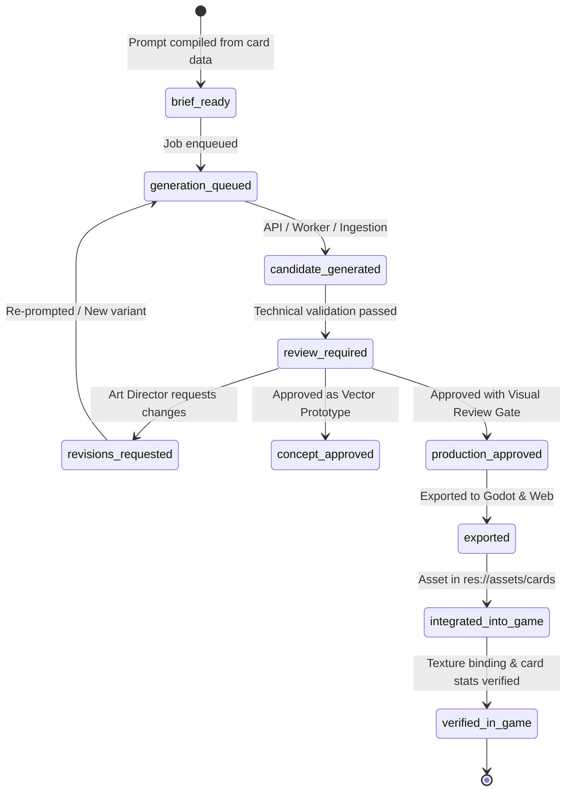

# HEARTHGLASS — ORIGINAL CARD ARTWORK PRODUCTION PIPELINE

## 1. Executive Summary & Pipeline Purpose

The Hearthglass Art Production Pipeline is the authoritative subsystem governing the generation, candidate management, provenance tracking, human review, technical validation, and engine export of all 640 original card illustrations across all eight factions and the neutral Lumenport Accord.

### Core Safeguards & Guarantees
1. **Strict Concept vs Production Separation**: The 8 initial deterministic SVG concepts (`hearthglass-prismatic-illustrator-v1`) are strictly classified as `stylized_vector_concept` and tracked under `concept_approved`. They are **never** counted as `final_production_artwork_approved` (0 approved initially, until real visual-inspected raster illustrations are reviewed).
2. **Zero Response Fabrication**: No mock or hallucinated responses are ever claimed as live AI generations. The system clearly distinguishes `live_tested`, `mock_tested`, `configured_untested`, and `unconfigured` adapters.
3. **Budget Safety Lock**: Server-side budget limits (`budget_limit_usd`) strictly prevent incurring paid hosted API charges without explicit administrative authorization.
4. **Master Asset Preservation**: Ingested candidate raster bytes (PNG, WebP, JPEG) are preserved verbatim in `content/art/masters/<CARD_ID>/` without recompression or lossy re-encoding.
5. **Human Visual Review Gate**: Final production approval requires authenticated reviewer identity (`approved_by`), recorded visual review (`visual_review_passed: true`), and quality confirmation (`visual_quality_confirmed: true`).
6. **Dual-Target Godot & Web Export**: Approved assets are automatically mirrored to `apps/game-client/assets/cards/` (with Godot 4.x `.import` texture metadata) and `apps/content-studio/public/assets/cards/`.

---

## 2. Supported Image Providers & Remote GPU Workers

| Provider ID | Provider Name | Type | Model ID | Target Tier | Env Variable | Cost / Img | License |
|---|---|---|---|---|---|---|---|
| `flux_2_klein` | FLUX.2 Klein (Hosted API) | Hosted API | `black-forest-labs/flux-2-klein` | Final Production | `FLUX_API_KEY` / `FAL_KEY` | $0.015 | Commercial Hosted API |
| `z_image_turbo` | Z-Image Turbo (Fast Diffusion) | Hosted API | `z-image/z-image-turbo-v1` | Final Production | `Z_IMAGE_API_KEY` / `REPLICATE_API_TOKEN` | $0.008 | Apache-2.0 / Commercial |
| `qwen_image` | Qwen-Image (DashScope / Wanx) | Hosted API | `qwen/qwen-image-v2` | Final Production | `QWEN_IMAGE_API_KEY` / `DASHSCOPE_API_KEY` | $0.012 | Tongyi Commercial API |
| `flux_1_schnell` | FLUX.1 Schnell (Together AI) | Hosted API | `black-forest-labs/FLUX.1-schnell` | Final Production | `TOGETHER_API_KEY` / `HF_TOKEN` | $0.003 | Apache-2.0 |
| `remote_comfyui` | Remote ComfyUI Worker Node | Remote Worker | `comfyui-hearthglass-sdxl-flux-workflow` | Final Production | `COMFYUI_REMOTE_URL` | $0.000 | Self-Managed Worker |
| `self_hosted_worker` | Self-Hosted Cloud GPU Worker | Remote Worker | `hearthglass-gpu-worker-v1` | Final Production | `HEARTHGLASS_GPU_WORKER_URL` | $0.000 | Internal Studio Worker |
| `studio_stylized_svg` | Hearthglass Vector Illustrator | Built-in Engine | `hearthglass-prismatic-illustrator-v1` | Vector Concept | None (Built-in) | $0.000 | First-Party Studio Engine |
| `manual_upload` | Manual Artist / Studio Upload | Manual Import | `manual-artist-upload` | Final Production | None (Direct File) | $0.000 | First-Party Studio Asset |
| `batch_export` | Batch Prompt JSONL Exporter | Pipeline Exporter | `batch-jsonl-v1` | Prompt Export | None (File Export) | $0.000 | First-Party Pipeline |

---

## 3. Production Lifecycle States



---

## 4. Faction Visual Directives & Reference Guides

Stored canonically in [`content/art/faction_reference_sheets.json`](file:///C:/Users/billy/.t3/worktrees/hearthglass/feat-art-production-pip-3efc1595aa5a6589/content/art/faction_reference_sheets.json):

1. **Emberclad**: Volcanic obsidian, blackened iron, smoldering heat cracks, glowing amber-orange underlighting (`#ff5d2e`, `#ffb347`, `#120709`).
2. **Verdant Pact**: Ancient primordial woodland, ironwood bark, bioluminescent moss, glowing emerald spores (`#37d67a`, `#9be564`, `#07140f`).
3. **Iron Choir**: Gothic clockwork steampunk, polished ecclesiastical brass, church organs, cyan aether tubes (`#d4a359`, `#4de1ff`, `#0b101a`).
4. **Tidebound**: Oceanic abyss, coral chitin, iridescent pearl nacre, caustic wave refractions (`#22d3ee`, `#38bdf8`, `#04101e`).
5. **Glassborne**: Prismatic crystal refraction, mirrored galleries, violet twilight, faceted geometric jewelry (`#c084fc`, `#67e8f9`, `#0c091c`).
6. **Nocturne**: Dark gothic chiaroscuro, blood moon rim lighting, raven feathers, midnight velvet, silver masks (`#818cf8`, `#e11d48`, `#05050d`).
7. **Starweave**: Cosmic celestial, brass armillary spheres, constellation embroidery, deep indigo nebula (`#fbbf24`, `#60a5fa`, `#070414`).
8. **Gravewild**: Barrow ossuary, bleached leviathan bone, thorny black briars, neon lime will-o'-the-wisps (`#a3e635`, `#be123c`, `#0a0b09`).
9. **Neutral**: Warm Lumenport tavern, cobblestone harbor, tanned leather, forged iron lantern light (`#eab308`, `#94a3b8`, `#0c0f17`).

---

## 5. First Target: The Eight Signature Faction Illustrations

Stored canonically in [`content/art/showcase_production_specs.json`](file:///C:/Users/billy/.t3/worktrees/hearthglass/feat-art-production-pip-3efc1595aa5a6589/content/art/showcase_production_specs.json):

1. **`EMB-C-0001` (Ashborne Initiate)**: Emberclad 1-cost Vanguard. Volcanic Cinder Anvil forge, obsidian gauntlets glowing white-hot with molten heat cracks reflecting the Heat counter mechanic.
2. **`VER-C-0001` (Mossveil Tender)**: Verdant Pact 1-cost Support. Primordial elder grove, cupping glowing emerald Echo seeds bursting into life depicting Growth and Vitality restoration.
3. **`IRN-C-0001` (Cogline Recruit)**: Iron Choir 1-cost Vanguard. Third Foundry industrial cathedral, porcelain faceplate, brass interlocking gear shield and cyan aether tubes depicting Shield and Assembly mechanics.
4. **`TID-C-0001` (Reefstep Scout)**: Tidebound 1-cost Vanguard. Twilight surf, coral reef rocks, cerulean and pearl chitin armor, leaping dynamic motion with rushing water ribbons depicting Skirmish and Current lane shifts.
5. **`GLS-C-0001` (Prismblade Apprentice)**: Glassborne 1-cost Vanguard. Mirror Galleries, faceted crystal rapier, crystalline Ward barrier, triple-refraction light silhouettes depicting Ward and multi-angle strike.
6. **`NOC-C-0001` (Crescent Alley Stalker)**: Nocturne 1-cost Assassin. Crescent District foggy cobbled rooftop, blood-red moon, cloak dissolving into raven feathers and shadow smoke depicting Stealth and Veil.
7. **`STR-C-0001` (Astrolabe Student)**: Starweave 1-cost Caster. Celestial Spire observatory, armillary sphere, orbiting golden constellation glyphs depicting Alignment counter and top-card inspection.
8. **`GRV-C-0001` (Bonefield Wanderer)**: Gravewild 1-cost Vanguard. Mist-shrouded barrow swamp, leviathan bone construct bound by briars, glowing lime-green flame in skull, hovering translucent Echo Remnant depicting Rebirth.

---

## 6. Live Provider Integration Instructions

When authorized to run live raster illustration generation, configure the target provider credentials in `.env` or process environment:

```bash
# FLUX.2 Klein / Dev via fal.ai
export FLUX_API_KEY="your-fal-or-bfl-api-key"
export ART_AUTHORIZED_BUDGET_USD="25.00"

# Z-Image Turbo via Replicate
export REPLICATE_API_TOKEN="r8_your_replicate_token"

# Qwen-Image via Alibaba DashScope
export DASHSCOPE_API_KEY="sk-your-dashscope-key"

# Remote ComfyUI Worker Node
export COMFYUI_REMOTE_URL="http://gpu-worker-01.internal:8188"

# Self-Hosted Cloud GPU Worker
export HEARTHGLASS_GPU_WORKER_URL="http://hearthglass-worker.cloud:8000"
```

Once configured, the Content Studio UI automatically updates provider status from `KEY NEEDED` to `READY`, allowing single-card or batch faction generation. If credentials are not supplied, the system operates cleanly in mock test mode or deterministic vector concept mode without incurring charges or fabricating responses.
